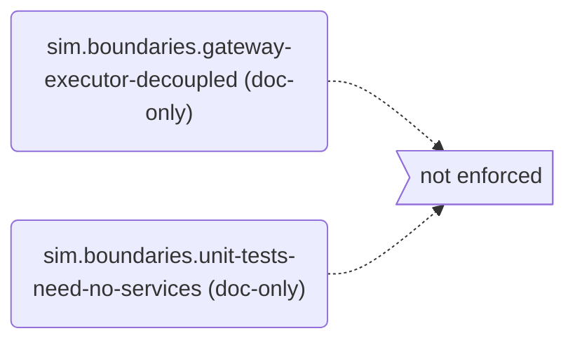
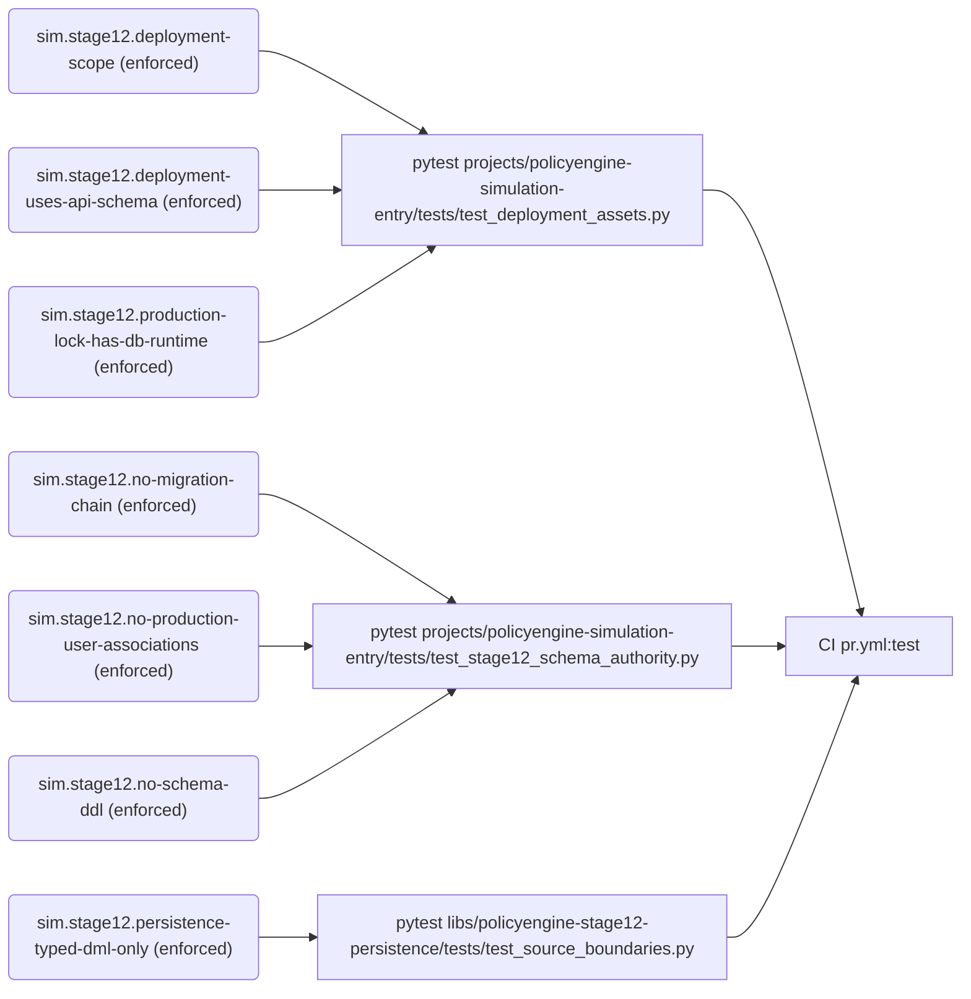
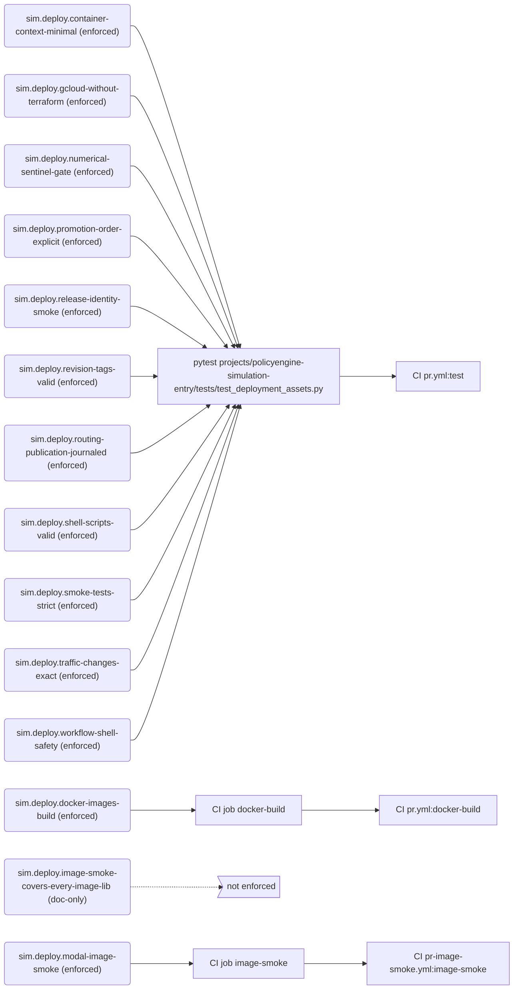
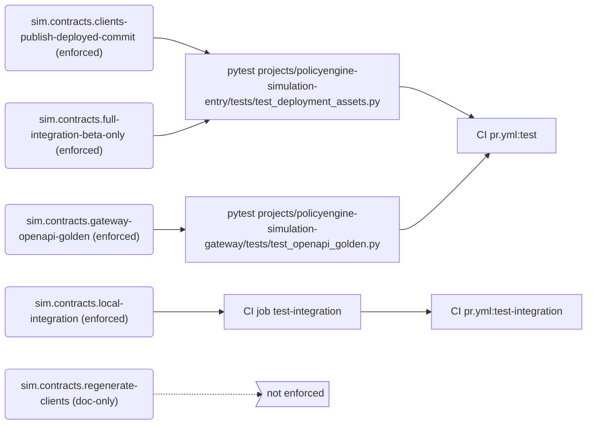
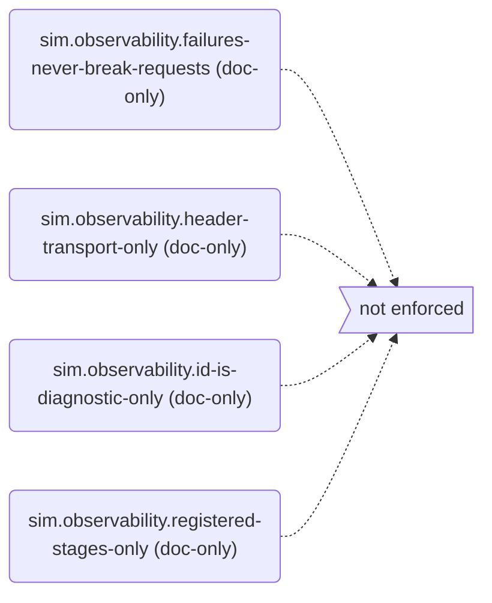
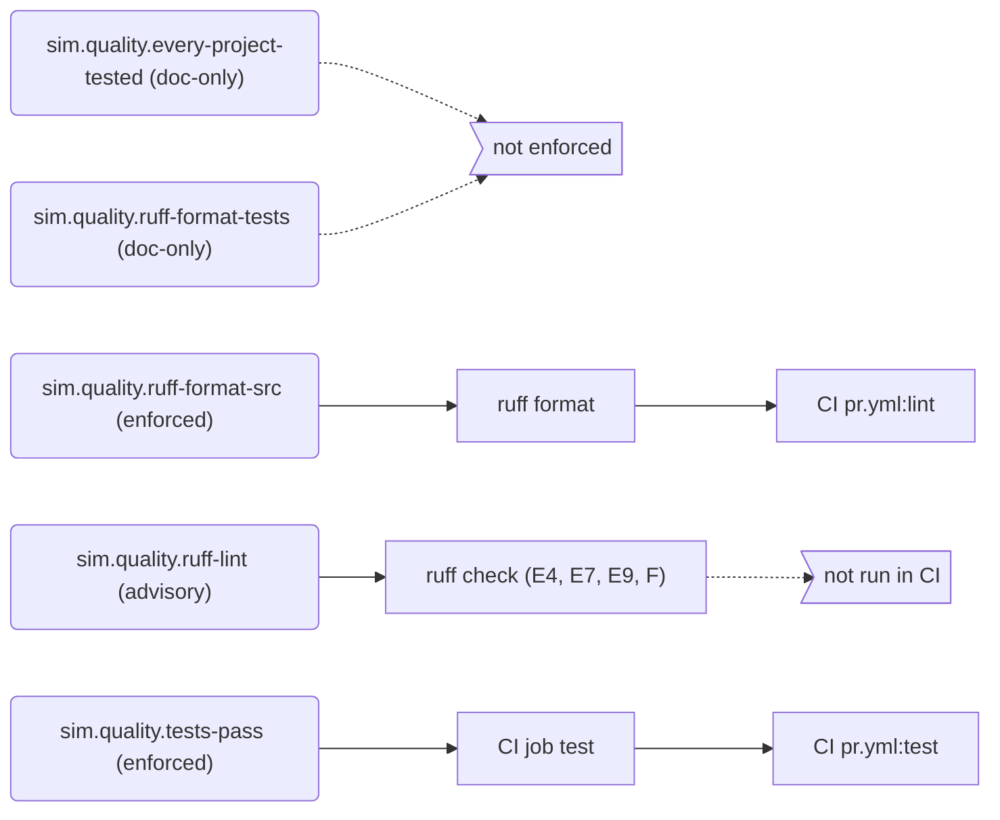
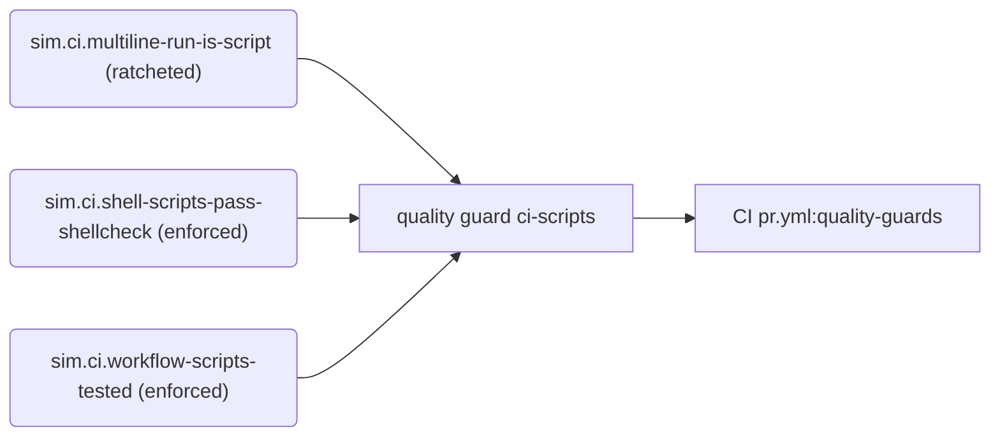
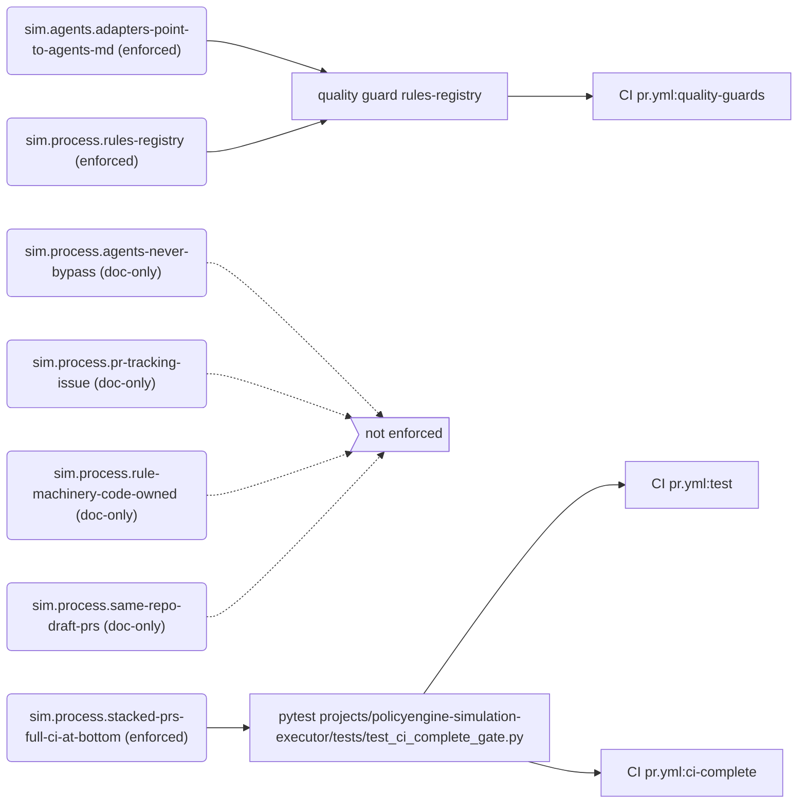

# Rules

Generated by `python -m scripts.rules render` from `rules/registry.toml`. Do not edit by hand.

Every rule that governs `policyengine-sim-api` is listed here with how it is enforced. Blocking rules fail CI. The Gaps section lists what is written down but not yet enforced or proven. To add or change a rule, see `docs/engineering/skills/rules-registry.md`.

## Summary

| Tier | enforced | ratcheted | advisory | doc-only | Total |
| --- | ---: | ---: | ---: | ---: | ---: |
| mechanical | 31 | 1 | 1 | 14 | 47 |
| metric | 0 | 0 | 0 | 0 | 0 |
| judgment | 0 | 0 | 0 | 0 | 0 |

**Blocking:** 32 of 47 rules.

## Gaps

### Not enforced (doc-only)

- `sim.boundaries.gateway-executor-decoupled`: The gateway and executor never import each other; they communicate only through the models and state helpers in policyengine-simulation-contract.
- `sim.boundaries.unit-tests-need-no-services`: Unit tests never require real network credentials, Modal, Hugging Face, GCP or deployed services; those seams are mocked.
- `sim.contracts.regenerate-clients`: When public API schemas change, regenerate the clients and run the generated-client integration tests.
- `sim.deploy.image-smoke-covers-every-image-lib`: The image smoke path filter includes every library mounted into a Modal image, so a change to any of them runs the smoke.
- `sim.observability.failures-never-break-requests`: Invalid observability configuration fails at build or deploy time, and telemetry failures at runtime never fail a request or computation.
- `sim.observability.header-transport-only`: observability_id travels only in the X-PolicyEngine-Observability-Id header, never in a simulation JSON body, and polling never invents one.
- `sim.observability.id-is-diagnostic-only`: observability_id has diagnostic meaning only: never use it for idempotency, authorization, database identity, routing or business logic.
- `sim.observability.registered-stages-only`: Span names come from the stage plans in policyengine_simulation_observability.stages; runtime code never adds span-name string literals.
- `sim.process.agents-never-bypass`: Agents never bypass branch rules, even with admin credentials: no gh pr merge --admin and no bypass option; a blocked merge is reported to a human.
- `sim.process.pr-tracking-issue`: Every PR has a tracking issue in this repository, and the first line of its description is Fixes #ISSUE_NUMBER.
- `sim.process.rule-machinery-code-owned`: Changes to the rule machinery (rules/, scripts/rules/, scripts/run_quality_guards.py and CODEOWNERS) need approval from a core developer other than the author.
- `sim.process.same-repo-draft-prs`: PRs are opened as drafts from branches in PolicyEngine/policyengine-sim-api, never from forks.
- `sim.quality.every-project-tested`: Every project and library with unit tests runs them in the PR test matrix.
- `sim.quality.ruff-format-tests`: Test code is formatted with ruff format too; CI currently checks only src directories.

### Advisory (checked but not blocking)

- `sim.quality.ruff-lint`: Python code passes ruff check with the rules selected in ruff.toml (ruff's defaults, made explicit); CI does not run ruff check yet.

### Unproven (no proof that the checker rejects a bad example)

- `sim.contracts.clients-publish-deployed-commit`
- `sim.contracts.full-integration-beta-only`
- `sim.contracts.gateway-openapi-golden`
- `sim.deploy.container-context-minimal`
- `sim.deploy.gcloud-without-terraform`
- `sim.deploy.numerical-sentinel-gate`
- `sim.deploy.promotion-order-explicit`
- `sim.deploy.release-identity-smoke`
- `sim.deploy.revision-tags-valid`
- `sim.deploy.routing-publication-journaled`
- `sim.deploy.shell-scripts-valid`
- `sim.deploy.smoke-tests-strict`
- `sim.deploy.traffic-changes-exact`
- `sim.deploy.workflow-shell-safety`
- `sim.process.rules-registry`
- `sim.stage12.deployment-scope`
- `sim.stage12.deployment-uses-api-schema`
- `sim.stage12.no-migration-chain`
- `sim.stage12.no-production-user-associations`
- `sim.stage12.persistence-typed-dml-only`
- `sim.stage12.production-lock-has-db-runtime`

### Ratcheted (existing violations still tolerated)

- `sim.ci.multiline-run-is-script`: 27 remaining in `rules/baselines/ci-multiline-run.txt`

### Exceptions and review dates

- None.

## Service and package boundaries

| Rule | Statement | Tier | Status | Blocking | Enforced by | CI | Proof |
| --- | --- | --- | --- | --- | --- | --- | --- |
| `sim.boundaries.gateway-executor-decoupled` | The gateway and executor never import each other; they communicate only through the models and state helpers in policyengine-simulation-contract. | mechanical | doc-only | no | nothing | — | — |
| `sim.boundaries.unit-tests-need-no-services` | Unit tests never require real network credentials, Modal, Hugging Face, GCP or deployed services; those seams are mocked. | mechanical | doc-only | no | nothing | — | — |

## Stage 12 persistence

| Rule | Statement | Tier | Status | Blocking | Enforced by | CI | Proof |
| --- | --- | --- | --- | --- | --- | --- | --- |
| `sim.stage12.deployment-scope` | Main-branch deploys roll out Stage 12 in both environments; a Stage 12-only deploy runs candidate tests and the requested promotion but never redeploys existing Modal resources; the Stage 12 worker can request a Google OIDC token. | mechanical | enforced | yes | pytest `projects/policyengine-simulation-entry/tests/test_deployment_assets.py` | `pr.yml:test` | **unproven** |
| `sim.stage12.deployment-uses-api-schema` | Stage 12 deployment uses the API-owned schema directly, and the Stage 12 runtime it deploys uses typed DML without raw SQL or schema changes. | mechanical | enforced | yes | pytest `projects/policyengine-simulation-entry/tests/test_deployment_assets.py` | `pr.yml:test` | **unproven** |
| `sim.stage12.no-migration-chain` | This repository has no schema migration chain (no Alembic); Stage 12 tables are migrated by policyengine-api. | mechanical | enforced | yes | pytest `projects/policyengine-simulation-entry/tests/test_stage12_schema_authority.py` | `pr.yml:test` | **unproven** |
| `sim.stage12.no-production-user-associations` | Stage 12 runtime modules never create production user associations (user_simulations or user_reports). | mechanical | enforced | yes | pytest `projects/policyengine-simulation-entry/tests/test_stage12_schema_authority.py` | `pr.yml:test` | **unproven** |
| `sim.stage12.no-schema-ddl` | Simulation runtimes and the Stage 12 persistence library contain no schema DDL (CREATE, ALTER, DROP or TRUNCATE of tables, types, schemas or databases, or create_all); policyengine-api owns the schema. | mechanical | enforced | yes | pytest `projects/policyengine-simulation-entry/tests/test_stage12_schema_authority.py` | `pr.yml:test` | yes |
| `sim.stage12.persistence-typed-dml-only` | The Stage 12 persistence library and runtime use typed SQLAlchemy Core DML only: no raw SQL text, driver-level SQL or schema operations. | mechanical | enforced | yes | pytest `libs/policyengine-stage12-persistence/tests/test_source_boundaries.py` | `pr.yml:test` | **unproven** |
| `sim.stage12.production-lock-has-db-runtime` | The production lock file includes the direct Stage 12 database runtime dependencies. | mechanical | enforced | yes | pytest `projects/policyengine-simulation-entry/tests/test_deployment_assets.py` | `pr.yml:test` | **unproven** |

## Deployment pipeline

| Rule | Statement | Tier | Status | Blocking | Enforced by | CI | Proof |
| --- | --- | --- | --- | --- | --- | --- | --- |
| `sim.deploy.container-context-minimal` | Container builds exclude local environments and unrelated projects, and the entrypoint container builds for the requested target platform. | mechanical | enforced | yes | pytest `projects/policyengine-simulation-entry/tests/test_deployment_assets.py` | `pr.yml:test` | **unproven** |
| `sim.deploy.docker-images-build` | The simulation entry and executor Docker images build. | mechanical | enforced | yes | CI job `docker-build` | `pr.yml:docker-build` | — |
| `sim.deploy.gcloud-without-terraform` | Deployment uses the gcloud-based workflow, not Terraform. | mechanical | enforced | yes | pytest `projects/policyengine-simulation-entry/tests/test_deployment_assets.py` | `pr.yml:test` | **unproven** |
| `sim.deploy.image-smoke-covers-every-image-lib` | The image smoke path filter includes every library mounted into a Modal image, so a change to any of them runs the smoke. | mechanical | doc-only | no | nothing | — | — |
| `sim.deploy.modal-image-smoke` | App entrypoints import inside the real Modal images before merge, whenever a library baked into an image changes. | mechanical | enforced | yes | CI job `image-smoke` | `pr-image-smoke.yml:image-smoke` | — |
| `sim.deploy.numerical-sentinel-gate` | An existing-stack deployment computes the numerical release sentinel from the exact bundle it installs, and the candidate and stable services must reproduce it; a failing sentinel check fails its step. | mechanical | enforced | yes | pytest `projects/policyengine-simulation-entry/tests/test_deployment_assets.py` | `pr.yml:test` | **unproven** |
| `sim.deploy.promotion-order-explicit` | Full-stack promotion order is explicit, and the reusable deployment rejects unexpectedly skipped phases. | mechanical | enforced | yes | pytest `projects/policyengine-simulation-entry/tests/test_deployment_assets.py` | `pr.yml:test` | **unproven** |
| `sim.deploy.release-identity-smoke` | Deploy gates pass the whole release identity to the entrypoint smoke, which requires every expectation, refuses malformed ones, and rejects a release whose routes, latest pointers, bundle, UK model or UK dataset differ from that identity. | mechanical | enforced | yes | pytest `projects/policyengine-simulation-entry/tests/test_deployment_assets.py` | `pr.yml:test` | **unproven** |
| `sim.deploy.revision-tags-valid` | Cloud Run revision tags are valid on a workflow's first run and fit the existing service names. | mechanical | enforced | yes | pytest `projects/policyengine-simulation-entry/tests/test_deployment_assets.py` | `pr.yml:test` | **unproven** |
| `sim.deploy.routing-publication-journaled` | Each routing publication is named by its run, attempt and environment and journaled before it is applied; an always-running finalizer resolves it from the journal with the release-gate outcome, a release reports success only after that finalizer completes, and routing jobs never tolerate a failed command. | mechanical | enforced | yes | pytest `projects/policyengine-simulation-entry/tests/test_deployment_assets.py` | `pr.yml:test` | **unproven** |
| `sim.deploy.shell-scripts-valid` | Deployment shell scripts have valid shell syntax. | mechanical | enforced | yes | pytest `projects/policyengine-simulation-entry/tests/test_deployment_assets.py` | `pr.yml:test` | **unproven** |
| `sim.deploy.smoke-tests-strict` | Candidate and stable smoke tests reject a revision mismatch without retrying, and fail if the previous revision does not converge. | mechanical | enforced | yes | pytest `projects/policyengine-simulation-entry/tests/test_deployment_assets.py` | `pr.yml:test` | **unproven** |
| `sim.deploy.traffic-changes-exact` | Traffic changes target an exact, validated revision, are reversible, and refuse to run over an intervening promotion. | mechanical | enforced | yes | pytest `projects/policyengine-simulation-entry/tests/test_deployment_assets.py` | `pr.yml:test` | **unproven** |
| `sim.deploy.workflow-shell-safety` | Cloud Run deployment never interpolates GitHub expressions into shell, escapes environment values, and pins secret versions. | mechanical | enforced | yes | pytest `projects/policyengine-simulation-entry/tests/test_deployment_assets.py` | `pr.yml:test` | **unproven** |

## API contracts and integration

| Rule | Statement | Tier | Status | Blocking | Enforced by | CI | Proof |
| --- | --- | --- | --- | --- | --- | --- | --- |
| `sim.contracts.clients-publish-deployed-commit` | Client publication checks out the commit that was actually deployed. | mechanical | enforced | yes | pytest `projects/policyengine-simulation-entry/tests/test_deployment_assets.py` | `pr.yml:test` | **unproven** |
| `sim.contracts.full-integration-beta-only` | The complete integration suite runs against beta deployments only, never production. | mechanical | enforced | yes | pytest `projects/policyengine-simulation-entry/tests/test_deployment_assets.py` | `pr.yml:test` | **unproven** |
| `sim.contracts.gateway-openapi-golden` | The gateway's OpenAPI spec matches the checked-in golden file; regenerate it deliberately when the API changes. | mechanical | enforced | yes | pytest `projects/policyengine-simulation-gateway/tests/test_openapi_golden.py` | `pr.yml:test` | **unproven** |
| `sim.contracts.local-integration` | Generated-client integration tests pass against the locally built services. | mechanical | enforced | yes | CI job `test-integration` | `pr.yml:test-integration` | — |
| `sim.contracts.regenerate-clients` | When public API schemas change, regenerate the clients and run the generated-client integration tests. | mechanical | doc-only | no | nothing | — | — |

## Observability

| Rule | Statement | Tier | Status | Blocking | Enforced by | CI | Proof |
| --- | --- | --- | --- | --- | --- | --- | --- |
| `sim.observability.failures-never-break-requests` | Invalid observability configuration fails at build or deploy time, and telemetry failures at runtime never fail a request or computation. | mechanical | doc-only | no | nothing | — | — |
| `sim.observability.header-transport-only` | observability_id travels only in the X-PolicyEngine-Observability-Id header, never in a simulation JSON body, and polling never invents one. | mechanical | doc-only | no | nothing | — | — |
| `sim.observability.id-is-diagnostic-only` | observability_id has diagnostic meaning only: never use it for idempotency, authorization, database identity, routing or business logic. | mechanical | doc-only | no | nothing | — | — |
| `sim.observability.registered-stages-only` | Span names come from the stage plans in policyengine_simulation_observability.stages; runtime code never adds span-name string literals. | mechanical | doc-only | no | nothing | — | — |

## Code quality and tests

| Rule | Statement | Tier | Status | Blocking | Enforced by | CI | Proof |
| --- | --- | --- | --- | --- | --- | --- | --- |
| `sim.quality.every-project-tested` | Every project and library with unit tests runs them in the PR test matrix. | mechanical | doc-only | no | nothing | — | — |
| `sim.quality.ruff-format-src` | Source code under projects/*/src and libs/*/src is formatted with ruff format. | mechanical | enforced | yes | ruff format | `pr.yml:lint` | — |
| `sim.quality.ruff-format-tests` | Test code is formatted with ruff format too; CI currently checks only src directories. | mechanical | doc-only | no | nothing | — | — |
| `sim.quality.ruff-lint` | Python code passes ruff check with the rules selected in ruff.toml (ruff's defaults, made explicit); CI does not run ruff check yet. | mechanical | advisory | no | ruff check (E4, E7, E9, F) | — | — |
| `sim.quality.tests-pass` | Each project's unit tests pass in its own locked environment. | mechanical | enforced | yes | CI job `test` | `pr.yml:test` | — |

## CI workflows and scripts

| Rule | Statement | Tier | Status | Blocking | Enforced by | CI | Proof |
| --- | --- | --- | --- | --- | --- | --- | --- |
| `sim.ci.multiline-run-is-script` | A GitHub Actions run: block holds one line of code and no chained commands (&&, \|\|, ;); anything more lives in a tested script under .github/scripts/, called from a single-line step. | mechanical | ratcheted | yes | quality guard `ci-scripts` | `pr.yml:quality-guards` | yes |
| `sim.ci.shell-scripts-pass-shellcheck` | Every shell script under .github/scripts/ passes shellcheck. | mechanical | enforced | yes | quality guard `ci-scripts` | `pr.yml:quality-guards` | yes |
| `sim.ci.workflow-scripts-tested` | Every shell script a workflow calls is run by at least one test. | mechanical | enforced | yes | quality guard `ci-scripts` | `pr.yml:quality-guards` | yes |

## Process and repository hygiene

| Rule | Statement | Tier | Status | Blocking | Enforced by | CI | Proof |
| --- | --- | --- | --- | --- | --- | --- | --- |
| `sim.agents.adapters-point-to-agents-md` | CLAUDE.md and .github/copilot-instructions.md only point to AGENTS.md; skills and rules are listed in AGENTS.md alone. | mechanical | enforced | yes | quality guard `rules-registry` | `pr.yml:quality-guards` | yes |
| `sim.process.agents-never-bypass` | Agents never bypass branch rules, even with admin credentials: no gh pr merge --admin and no bypass option; a blocked merge is reported to a human. | mechanical | doc-only | no | nothing | — | — |
| `sim.process.pr-tracking-issue` | Every PR has a tracking issue in this repository, and the first line of its description is Fixes #ISSUE_NUMBER. | mechanical | doc-only | no | nothing | — | — |
| `sim.process.rule-machinery-code-owned` | Changes to the rule machinery (rules/, scripts/rules/, scripts/run_quality_guards.py and CODEOWNERS) need approval from a core developer other than the author. | mechanical | doc-only | no | nothing | — | — |
| `sim.process.rules-registry` | Every rule is registered in rules/registry.toml, is enforced where it claims to be, and its rendered views are current. | mechanical | enforced | yes | quality guard `rules-registry` | `pr.yml:quality-guards` | **unproven** |
| `sim.process.same-repo-draft-prs` | PRs are opened as drafts from branches in PolicyEngine/policyengine-sim-api, never from forks. | mechanical | doc-only | no | nothing | — | — |
| `sim.process.stacked-prs-full-ci-at-bottom` | In a stack of pull requests, only the lowest unmerged one runs the full PR workflow and the Modal image smoke. Every pr.yml job is needed by the CI complete gate, which fails on the pull requests above it and otherwise passes only when every job passed, so a stack merges bottom-up and nothing merges untested. | mechanical | enforced | yes | pytest `projects/policyengine-simulation-executor/tests/test_ci_complete_gate.py` | `pr.yml:test`, `pr.yml:ci-complete` | yes |

