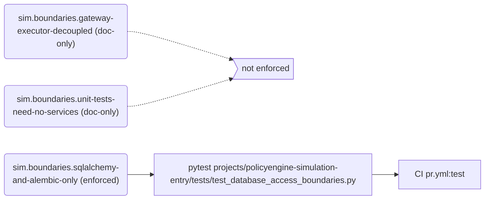
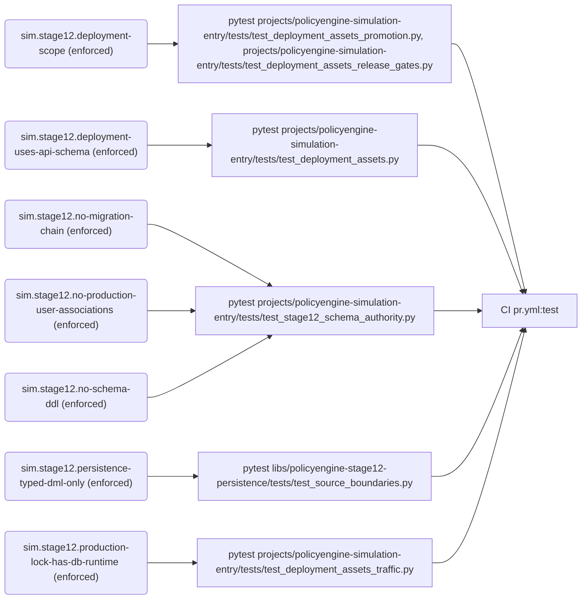
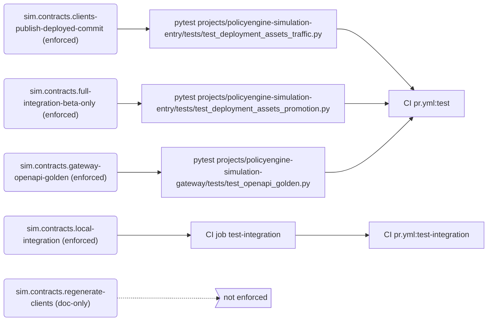
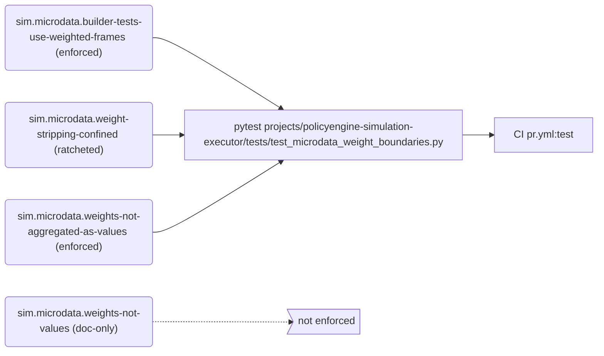
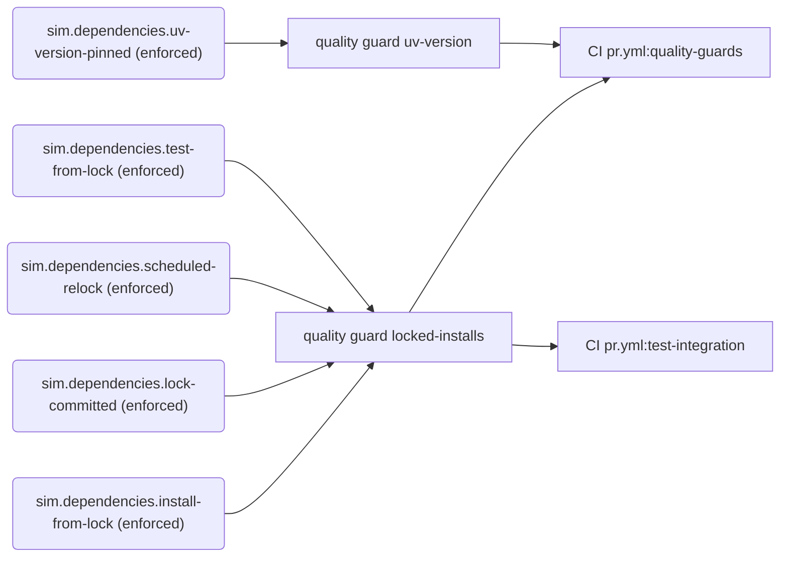
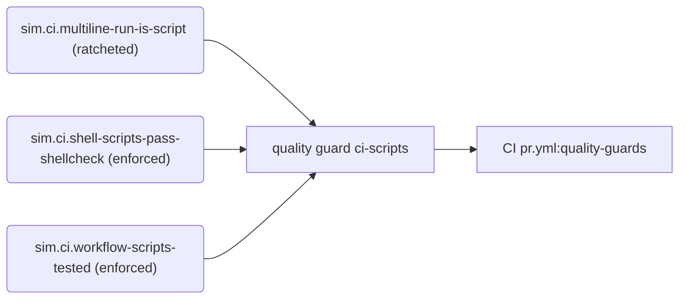
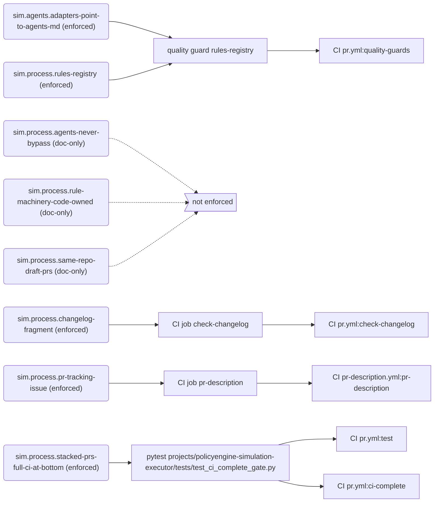

# Rules

Generated by `python -m scripts.rules render` from `rules/registry.toml`. Do not edit by hand.

Every rule that governs `policyengine-sim-api` is listed here with how it is enforced. Blocking rules fail CI. The Gaps section lists what is written down but not yet enforced or proven. To add or change a rule, see `docs/engineering/skills/rules-registry.md`.

## Summary

| Tier | enforced | ratcheted | advisory | doc-only | Total |
| --- | ---: | ---: | ---: | ---: | ---: |
| mechanical | 56 | 2 | 0 | 14 | 72 |
| metric | 1 | 0 | 0 | 0 | 1 |
| judgment | 0 | 0 | 0 | 0 | 0 |

**Blocking:** 59 of 73 rules.

## Gaps

### Not enforced (doc-only)

- `sim.boundaries.gateway-executor-decoupled`: The gateway and executor never import each other; they communicate only through the models and state helpers in policyengine-simulation-contract.
- `sim.boundaries.unit-tests-need-no-services`: Unit tests never require real network credentials, Modal, Hugging Face, GCP or deployed services; those seams are mocked.
- `sim.contracts.regenerate-clients`: When public API schemas change, regenerate the clients and run the generated-client integration tests.
- `sim.deploy.image-smoke-covers-every-image-lib`: The image smoke path filter includes every library mounted into a Modal image, so a change to any of them runs the smoke.
- `sim.microdata.weights-not-values`: Microdata columns are weights, values, labels or counts: weights are only summed plainly to count entities or passed as weights=, values are aggregated with their own entity's weights, labels only group or filter, and counts derive from weights.
- `sim.observability.failures-never-break-requests`: Invalid observability configuration fails at build or deploy time, and telemetry failures at runtime never fail a request or computation.
- `sim.observability.header-transport-only`: observability_id travels only in the X-PolicyEngine-Observability-Id header, never in a simulation JSON body, and polling never invents one.
- `sim.observability.id-is-diagnostic-only`: observability_id has diagnostic meaning only: never use it for idempotency, authorization, database identity, routing or business logic.
- `sim.observability.registered-stages-only`: Span names come from the stage plans in policyengine_simulation_observability.stages; runtime code never adds span-name string literals.
- `sim.process.agents-never-bypass`: Agents never bypass branch rules, even with admin credentials: no gh pr merge --admin and no bypass option; a blocked merge is reported to a human.
- `sim.process.rule-machinery-code-owned`: Changes to the rule machinery (rules/, scripts/rules/, scripts/run_quality_guards.py and CODEOWNERS) need approval from a core developer other than the author.
- `sim.process.same-repo-draft-prs`: PRs are opened as drafts from branches in PolicyEngine/policyengine-sim-api, never from forks.
- `sim.quality.every-project-tested`: Every project and library with unit tests runs them in the PR test matrix.
- `sim.quality.ruff-format-tests`: Test code is formatted with ruff format too; CI currently checks only src directories.

### Advisory (checked but not blocking)

- None.

### Unproven (no proof that the checker rejects a bad example)

- `sim.contracts.clients-publish-deployed-commit`
- `sim.contracts.full-integration-beta-only`
- `sim.contracts.gateway-openapi-golden`
- `sim.deploy.container-context-minimal`
- `sim.deploy.gcloud-without-terraform`
- `sim.deploy.numerical-sentinel-gate`
- `sim.deploy.permission-enforcement-wired`
- `sim.deploy.promotion-order-explicit`
- `sim.deploy.release-identity-smoke`
- `sim.deploy.revision-tags-valid`
- `sim.deploy.routing-publication-journaled`
- `sim.deploy.shell-scripts-valid`
- `sim.deploy.smoke-tests-strict`
- `sim.deploy.traffic-changes-exact`
- `sim.deploy.workflow-shell-safety`
- `sim.process.rules-registry`
- `sim.stage12.deployment-scope`
- `sim.stage12.deployment-uses-api-schema`
- `sim.stage12.no-migration-chain`
- `sim.stage12.no-production-user-associations`
- `sim.stage12.persistence-typed-dml-only`
- `sim.stage12.production-lock-has-db-runtime`

### Ratcheted (existing violations still tolerated)

- `sim.ci.multiline-run-is-script`: 13 remaining in `rules/baselines/ci-multiline-run.txt`
- `sim.microdata.weight-stripping-confined`: 0 remaining in `rules/baselines/sim-microdata-weight-stripping.txt`

### Exceptions and review dates

- `sim.dependencies.install-from-lock`: exception for `.github/scripts/update-policyengine-package.sh` (`--with ${PACKAGE}==${LATEST}`) [pinned-tool] (The bundle updater reads the bundle versions of the PolicyEngine release it is about to lock, in an isolated environment outside any project; the release is pinned exactly and is not in any uv.lock yet.)
- `sim.dependencies.install-from-lock`: exception for `.github/workflows/pr.yml` (`pip install shellcheck-py==0.11.0.1`) [pinned-tool] (shellcheck is a binary the ci-scripts guard runs; the quality-guards job has no project environment, so it installs the exact shellcheck-py release.)
- `sim.dependencies.install-from-lock`: exception for `.github/workflows/pr.yml` (`uv tool install ruff==0.15.22`) [pinned-tool] (ruff is a repository-wide tool with no project of its own; ruff.toml sits at the root, which has no pyproject.toml or uv.lock, so the lint job installs the exact version ruff.toml is written for.)
- `sim.dependencies.install-from-lock`: exception for `Makefile` (`uv tool run ruff@$(RUFF_VERSION)`) [pinned-tool] (make format and make check run the ruff release pr.yml pins (RUFF_VERSION is read from its uv tool install ruff==<version>), outside any project, so local results match the lint job.)
- `sim.dependencies.test-from-lock`: exception for `.github/workflows/pr.yml` (`python -m unittest discover -s scripts/rules/tests`); remove when scripts/rules gains a pyproject.toml and uv.lock, or a third-party dependency (The rules tool under scripts/rules uses only the standard library and is not a project: the repository root has no pyproject.toml or uv.lock, so there is no locked environment to run its tests in.)

## Service and package boundaries

| Rule | Statement | Tier | Status | Blocking | Enforced by | CI | Proof |
| --- | --- | --- | --- | --- | --- | --- | --- |
| `sim.boundaries.gateway-executor-decoupled` | The gateway and executor never import each other; they communicate only through the models and state helpers in policyengine-simulation-contract. | mechanical | doc-only | no | nothing | — | — |
| `sim.boundaries.sqlalchemy-and-alembic-only` | Code connects to databases only through SQLAlchemy engines and connections, never by importing a database driver directly, and runtime code never changes the schema, which changes only through Alembic migrations. | mechanical | enforced | yes | pytest `projects/policyengine-simulation-entry/tests/test_database_access_boundaries.py` | `pr.yml:test` | yes |
| `sim.boundaries.unit-tests-need-no-services` | Unit tests never require real network credentials, Modal, Hugging Face, GCP or deployed services; those seams are mocked. | mechanical | doc-only | no | nothing | — | — |

## Stage 12 persistence

| Rule | Statement | Tier | Status | Blocking | Enforced by | CI | Proof |
| --- | --- | --- | --- | --- | --- | --- | --- |
| `sim.stage12.deployment-scope` | Main-branch deploys roll out Stage 12 in both environments; a Stage 12-only deploy runs candidate tests and the requested promotion but never redeploys existing Modal resources or runs the existing stack's complete integration suite; the Stage 12 worker can request a Google OIDC token. | mechanical | enforced | yes | pytest `projects/policyengine-simulation-entry/tests/test_deployment_assets_promotion.py`, `projects/policyengine-simulation-entry/tests/test_deployment_assets_release_gates.py` | `pr.yml:test` | **unproven** |
| `sim.stage12.deployment-uses-api-schema` | Stage 12 deployment uses the API-owned schema directly, and the Stage 12 runtime it deploys uses typed DML without raw SQL or schema changes. | mechanical | enforced | yes | pytest `projects/policyengine-simulation-entry/tests/test_deployment_assets.py` | `pr.yml:test` | **unproven** |
| `sim.stage12.no-migration-chain` | This repository has no schema migration chain (no Alembic); Stage 12 tables are migrated by policyengine-api. | mechanical | enforced | yes | pytest `projects/policyengine-simulation-entry/tests/test_stage12_schema_authority.py` | `pr.yml:test` | **unproven** |
| `sim.stage12.no-production-user-associations` | Stage 12 runtime modules never create production user associations (user_simulations or user_reports). | mechanical | enforced | yes | pytest `projects/policyengine-simulation-entry/tests/test_stage12_schema_authority.py` | `pr.yml:test` | **unproven** |
| `sim.stage12.no-schema-ddl` | Simulation runtimes and the Stage 12 persistence library contain no schema DDL (CREATE, ALTER, DROP or TRUNCATE of tables, types, schemas or databases, or create_all); policyengine-api owns the schema. | mechanical | enforced | yes | pytest `projects/policyengine-simulation-entry/tests/test_stage12_schema_authority.py` | `pr.yml:test` | yes |
| `sim.stage12.persistence-typed-dml-only` | The Stage 12 persistence library and runtime use typed SQLAlchemy Core DML only: no raw SQL text, driver-level SQL or schema operations. | mechanical | enforced | yes | pytest `libs/policyengine-stage12-persistence/tests/test_source_boundaries.py` | `pr.yml:test` | **unproven** |
| `sim.stage12.production-lock-has-db-runtime` | The production lock file includes the direct Stage 12 database runtime dependencies. | mechanical | enforced | yes | pytest `projects/policyengine-simulation-entry/tests/test_deployment_assets_traffic.py` | `pr.yml:test` | **unproven** |

## Deployment pipeline

| Rule | Statement | Tier | Status | Blocking | Enforced by | CI | Proof |
| --- | --- | --- | --- | --- | --- | --- | --- |
| `sim.deploy.container-context-minimal` | Container builds exclude local environments and unrelated projects, and the entrypoint container builds for the requested target platform. | mechanical | enforced | yes | pytest `projects/policyengine-simulation-entry/tests/test_deployment_assets_cloud_run.py`, `projects/policyengine-simulation-entry/tests/test_deployment_assets_traffic.py` | `pr.yml:test` | **unproven** |
| `sim.deploy.docker-images-build` | The simulation entry and executor Docker images build. | mechanical | enforced | yes | CI job `docker-build` | `pr.yml:docker-build` | — |
| `sim.deploy.gcloud-without-terraform` | Deployment uses the gcloud-based workflow, not Terraform. | mechanical | enforced | yes | pytest `projects/policyengine-simulation-entry/tests/test_deployment_assets.py` | `pr.yml:test` | **unproven** |
| `sim.deploy.image-smoke-covers-every-image-lib` | The image smoke path filter includes every library mounted into a Modal image, so a change to any of them runs the smoke. | mechanical | doc-only | no | nothing | — | — |
| `sim.deploy.modal-image-smoke` | App entrypoints import inside the real Modal images before merge, whenever a library baked into an image changes. | mechanical | enforced | yes | CI job `image-smoke` | `pr-image-smoke.yml:image-smoke` | — |
| `sim.deploy.numerical-sentinel-gate` | An existing-stack deployment computes the numerical release sentinel from the exact bundle it installs, and the candidate and stable services must reproduce it; a failing sentinel check fails its step. | mechanical | enforced | yes | pytest `projects/policyengine-simulation-entry/tests/test_deployment_assets_promotion.py`, `projects/policyengine-simulation-entry/tests/test_deployment_assets_release_gates.py` | `pr.yml:test` | **unproven** |
| `sim.deploy.permission-enforcement-wired` | Simulation Entrypoint permission enforcement defaults to log-only, rejects any value other than 0 or 1, and reaches the candidate revision and every deployed authentication run. | mechanical | enforced | yes | pytest `projects/policyengine-simulation-entry/tests/test_deployment_assets_cloud_run.py` | `pr.yml:test` | **unproven** |
| `sim.deploy.promotion-order-explicit` | Full-stack promotion order is explicit, and the reusable deployment rejects unexpectedly skipped phases. | mechanical | enforced | yes | pytest `projects/policyengine-simulation-entry/tests/test_deployment_assets_promotion.py` | `pr.yml:test` | **unproven** |
| `sim.deploy.release-commit-deploys-once` | A merge to main deploys only through the release commit the versioning job in simulation-deploy.yml pushes with the GitHub App token: every other push to main runs only that job, the release commit runs only the deploy jobs and never another release, a manual dispatch deploys without a release, and client publication follows only the release commit's run, so each merge deploys once and nothing loops. | mechanical | enforced | yes | pytest `projects/policyengine-simulation-entry/tests/test_release_workflow.py` | `pr.yml:test` | yes |
| `sim.deploy.release-identity-smoke` | Deploy gates pass the whole release identity to the entrypoint smoke, which requires every expectation, refuses malformed ones, and rejects a release whose routes, latest pointers, bundle, UK model or UK dataset differ from that identity. | mechanical | enforced | yes | pytest `projects/policyengine-simulation-entry/tests/test_deployment_assets_identity_smoke.py`, `projects/policyengine-simulation-entry/tests/test_deployment_assets_release_gates.py`, `projects/policyengine-simulation-entry/tests/test_deployment_assets_routing.py` | `pr.yml:test` | **unproven** |
| `sim.deploy.revision-tags-valid` | Cloud Run revision tags are valid on a workflow's first run and fit the existing service names. | mechanical | enforced | yes | pytest `projects/policyengine-simulation-entry/tests/test_deployment_assets_cloud_run.py` | `pr.yml:test` | **unproven** |
| `sim.deploy.routing-publication-journaled` | Each routing publication is named by its run, attempt and environment and journaled before it is applied; an always-running finalizer resolves it from the journal with the release-gate outcome, a release reports success only after that finalizer completes, and routing jobs never tolerate a failed command. | mechanical | enforced | yes | pytest `projects/policyengine-simulation-entry/tests/test_deployment_assets_release_gates.py`, `projects/policyengine-simulation-entry/tests/test_deployment_assets_routing.py` | `pr.yml:test` | **unproven** |
| `sim.deploy.shell-scripts-valid` | Deployment shell scripts have valid shell syntax. | mechanical | enforced | yes | pytest `projects/policyengine-simulation-entry/tests/test_deployment_assets.py` | `pr.yml:test` | **unproven** |
| `sim.deploy.smoke-tests-strict` | Candidate and stable smoke tests reject a revision mismatch without retrying, and fail if the previous revision does not converge. | mechanical | enforced | yes | pytest `projects/policyengine-simulation-entry/tests/test_deployment_assets.py` | `pr.yml:test` | **unproven** |
| `sim.deploy.traffic-changes-exact` | Traffic changes target an exact, validated revision, are reversible, and refuse to run over an intervening promotion. | mechanical | enforced | yes | pytest `projects/policyengine-simulation-entry/tests/test_deployment_assets_traffic.py` | `pr.yml:test` | **unproven** |
| `sim.deploy.workflow-shell-safety` | Cloud Run deployment never interpolates GitHub expressions into shell, escapes environment values, and pins secret versions. | mechanical | enforced | yes | pytest `projects/policyengine-simulation-entry/tests/test_deployment_assets_cloud_run.py` | `pr.yml:test` | **unproven** |

```mermaid
flowchart LR
  r_sim_deploy_container_context_minimal("sim.deploy.container-context-minimal (enforced)")
  e_pytest_projects_policyengine_simulation_entry_tests_test_deployment_assets_cloud_run_py__projects_policyengine_simulation_entry_tests_test_deployment_assets_traffic_py["pytest projects/policyengine-simulation-entry/tests/test_deployment_assets_cloud_run.py, projects/policyengine-simulation-entry/tests/test_deployment_assets_traffic.py"]
  j_CI_pr_yml_test["CI pr.yml:test"]
  r_sim_deploy_docker_images_build("sim.deploy.docker-images-build (enforced)")
  e_CI_job_docker_build["CI job docker-build"]
  j_CI_pr_yml_docker_build["CI pr.yml:docker-build"]
  r_sim_deploy_gcloud_without_terraform("sim.deploy.gcloud-without-terraform (enforced)")
  e_pytest_projects_policyengine_simulation_entry_tests_test_deployment_assets_py["pytest projects/policyengine-simulation-entry/tests/test_deployment_assets.py"]
  r_sim_deploy_image_smoke_covers_every_image_lib("sim.deploy.image-smoke-covers-every-image-lib (doc-only)")
  gap_unenforced>"not enforced"]
  r_sim_deploy_modal_image_smoke("sim.deploy.modal-image-smoke (enforced)")
  e_CI_job_image_smoke["CI job image-smoke"]
  j_CI_pr_image_smoke_yml_image_smoke["CI pr-image-smoke.yml:image-smoke"]
  r_sim_deploy_numerical_sentinel_gate("sim.deploy.numerical-sentinel-gate (enforced)")
  e_pytest_projects_policyengine_simulation_entry_tests_test_deployment_assets_promotion_py__projects_policyengine_simulation_entry_tests_test_deployment_assets_release_gates_py["pytest projects/policyengine-simulation-entry/tests/test_deployment_assets_promotion.py, projects/policyengine-simulation-entry/tests/test_deployment_assets_release_gates.py"]
  r_sim_deploy_permission_enforcement_wired("sim.deploy.permission-enforcement-wired (enforced)")
  e_pytest_projects_policyengine_simulation_entry_tests_test_deployment_assets_cloud_run_py["pytest projects/policyengine-simulation-entry/tests/test_deployment_assets_cloud_run.py"]
  r_sim_deploy_promotion_order_explicit("sim.deploy.promotion-order-explicit (enforced)")
  e_pytest_projects_policyengine_simulation_entry_tests_test_deployment_assets_promotion_py["pytest projects/policyengine-simulation-entry/tests/test_deployment_assets_promotion.py"]
  r_sim_deploy_release_commit_deploys_once("sim.deploy.release-commit-deploys-once (enforced)")
  e_pytest_projects_policyengine_simulation_entry_tests_test_release_workflow_py["pytest projects/policyengine-simulation-entry/tests/test_release_workflow.py"]
  r_sim_deploy_release_identity_smoke("sim.deploy.release-identity-smoke (enforced)")
  e_pytest_projects_policyengine_simulation_entry_tests_test_deployment_assets_identity_smoke_py__projects_policyengine_simulation_entry_tests_test_deployment_assets_release_gates_py__projects_policyengine_simulation_entry_tests_test_deployment_assets_routing_py["pytest projects/policyengine-simulation-entry/tests/test_deployment_assets_identity_smoke.py, projects/policyengine-simulation-entry/tests/test_deployment_assets_release_gates.py, projects/policyengine-simulation-entry/tests/test_deployment_assets_routing.py"]
  r_sim_deploy_revision_tags_valid("sim.deploy.revision-tags-valid (enforced)")
  r_sim_deploy_routing_publication_journaled("sim.deploy.routing-publication-journaled (enforced)")
  e_pytest_projects_policyengine_simulation_entry_tests_test_deployment_assets_release_gates_py__projects_policyengine_simulation_entry_tests_test_deployment_assets_routing_py["pytest projects/policyengine-simulation-entry/tests/test_deployment_assets_release_gates.py, projects/policyengine-simulation-entry/tests/test_deployment_assets_routing.py"]
  r_sim_deploy_shell_scripts_valid("sim.deploy.shell-scripts-valid (enforced)")
  r_sim_deploy_smoke_tests_strict("sim.deploy.smoke-tests-strict (enforced)")
  r_sim_deploy_traffic_changes_exact("sim.deploy.traffic-changes-exact (enforced)")
  e_pytest_projects_policyengine_simulation_entry_tests_test_deployment_assets_traffic_py["pytest projects/policyengine-simulation-entry/tests/test_deployment_assets_traffic.py"]
  r_sim_deploy_workflow_shell_safety("sim.deploy.workflow-shell-safety (enforced)")
  r_sim_deploy_container_context_minimal --> e_pytest_projects_policyengine_simulation_entry_tests_test_deployment_assets_cloud_run_py__projects_policyengine_simulation_entry_tests_test_deployment_assets_traffic_py
  e_pytest_projects_policyengine_simulation_entry_tests_test_deployment_assets_cloud_run_py__projects_policyengine_simulation_entry_tests_test_deployment_assets_traffic_py --> j_CI_pr_yml_test
  r_sim_deploy_docker_images_build --> e_CI_job_docker_build
  e_CI_job_docker_build --> j_CI_pr_yml_docker_build
  r_sim_deploy_gcloud_without_terraform --> e_pytest_projects_policyengine_simulation_entry_tests_test_deployment_assets_py
  e_pytest_projects_policyengine_simulation_entry_tests_test_deployment_assets_py --> j_CI_pr_yml_test
  r_sim_deploy_image_smoke_covers_every_image_lib -.-> gap_unenforced
  r_sim_deploy_modal_image_smoke --> e_CI_job_image_smoke
  e_CI_job_image_smoke --> j_CI_pr_image_smoke_yml_image_smoke
  r_sim_deploy_numerical_sentinel_gate --> e_pytest_projects_policyengine_simulation_entry_tests_test_deployment_assets_promotion_py__projects_policyengine_simulation_entry_tests_test_deployment_assets_release_gates_py
  e_pytest_projects_policyengine_simulation_entry_tests_test_deployment_assets_promotion_py__projects_policyengine_simulation_entry_tests_test_deployment_assets_release_gates_py --> j_CI_pr_yml_test
  r_sim_deploy_permission_enforcement_wired --> e_pytest_projects_policyengine_simulation_entry_tests_test_deployment_assets_cloud_run_py
  e_pytest_projects_policyengine_simulation_entry_tests_test_deployment_assets_cloud_run_py --> j_CI_pr_yml_test
  r_sim_deploy_promotion_order_explicit --> e_pytest_projects_policyengine_simulation_entry_tests_test_deployment_assets_promotion_py
  e_pytest_projects_policyengine_simulation_entry_tests_test_deployment_assets_promotion_py --> j_CI_pr_yml_test
  r_sim_deploy_release_commit_deploys_once --> e_pytest_projects_policyengine_simulation_entry_tests_test_release_workflow_py
  e_pytest_projects_policyengine_simulation_entry_tests_test_release_workflow_py --> j_CI_pr_yml_test
  r_sim_deploy_release_identity_smoke --> e_pytest_projects_policyengine_simulation_entry_tests_test_deployment_assets_identity_smoke_py__projects_policyengine_simulation_entry_tests_test_deployment_assets_release_gates_py__projects_policyengine_simulation_entry_tests_test_deployment_assets_routing_py
  e_pytest_projects_policyengine_simulation_entry_tests_test_deployment_assets_identity_smoke_py__projects_policyengine_simulation_entry_tests_test_deployment_assets_release_gates_py__projects_policyengine_simulation_entry_tests_test_deployment_assets_routing_py --> j_CI_pr_yml_test
  r_sim_deploy_revision_tags_valid --> e_pytest_projects_policyengine_simulation_entry_tests_test_deployment_assets_cloud_run_py
  r_sim_deploy_routing_publication_journaled --> e_pytest_projects_policyengine_simulation_entry_tests_test_deployment_assets_release_gates_py__projects_policyengine_simulation_entry_tests_test_deployment_assets_routing_py
  e_pytest_projects_policyengine_simulation_entry_tests_test_deployment_assets_release_gates_py__projects_policyengine_simulation_entry_tests_test_deployment_assets_routing_py --> j_CI_pr_yml_test
  r_sim_deploy_shell_scripts_valid --> e_pytest_projects_policyengine_simulation_entry_tests_test_deployment_assets_py
  r_sim_deploy_smoke_tests_strict --> e_pytest_projects_policyengine_simulation_entry_tests_test_deployment_assets_py
  r_sim_deploy_traffic_changes_exact --> e_pytest_projects_policyengine_simulation_entry_tests_test_deployment_assets_traffic_py
  e_pytest_projects_policyengine_simulation_entry_tests_test_deployment_assets_traffic_py --> j_CI_pr_yml_test
  r_sim_deploy_workflow_shell_safety --> e_pytest_projects_policyengine_simulation_entry_tests_test_deployment_assets_cloud_run_py
```

## API contracts and integration

| Rule | Statement | Tier | Status | Blocking | Enforced by | CI | Proof |
| --- | --- | --- | --- | --- | --- | --- | --- |
| `sim.contracts.clients-publish-deployed-commit` | Client publication checks out the commit that was actually deployed. | mechanical | enforced | yes | pytest `projects/policyengine-simulation-entry/tests/test_deployment_assets_traffic.py` | `pr.yml:test` | **unproven** |
| `sim.contracts.full-integration-beta-only` | The complete integration suite runs against beta deployments only, never production. | mechanical | enforced | yes | pytest `projects/policyengine-simulation-entry/tests/test_deployment_assets_promotion.py` | `pr.yml:test` | **unproven** |
| `sim.contracts.gateway-openapi-golden` | The gateway's OpenAPI spec matches the checked-in golden file; regenerate it deliberately when the API changes. | mechanical | enforced | yes | pytest `projects/policyengine-simulation-gateway/tests/test_openapi_golden.py` | `pr.yml:test` | **unproven** |
| `sim.contracts.local-integration` | Generated-client integration tests pass against the locally built services. | mechanical | enforced | yes | CI job `test-integration` | `pr.yml:test-integration` | — |
| `sim.contracts.regenerate-clients` | When public API schemas change, regenerate the clients and run the generated-client integration tests. | mechanical | doc-only | no | nothing | — | — |

## Observability

| Rule | Statement | Tier | Status | Blocking | Enforced by | CI | Proof |
| --- | --- | --- | --- | --- | --- | --- | --- |
| `sim.observability.failures-never-break-requests` | Invalid observability configuration fails at build or deploy time, and telemetry failures at runtime never fail a request or computation. | mechanical | doc-only | no | nothing | — | — |
| `sim.observability.header-transport-only` | observability_id travels only in the X-PolicyEngine-Observability-Id header, never in a simulation JSON body, and polling never invents one. | mechanical | doc-only | no | nothing | — | — |
| `sim.observability.id-is-diagnostic-only` | observability_id has diagnostic meaning only: never use it for idempotency, authorization, database identity, routing or business logic. | mechanical | doc-only | no | nothing | — | — |
| `sim.observability.registered-stages-only` | Span names come from the stage plans in policyengine_simulation_observability.stages; runtime code never adds span-name string literals. | mechanical | doc-only | no | nothing | — | — |

## Weighted microdata

| Rule | Statement | Tier | Status | Blocking | Enforced by | CI | Proof |
| --- | --- | --- | --- | --- | --- | --- | --- |
| `sim.microdata.builder-tests-use-weighted-frames` | Output-builder tests build entity frames only through fixtures/weighted_frames.weighted_entity_frame, as MicroDataFrames with non-uniform weights, never as plain pd.DataFrames. | mechanical | enforced | yes | pytest `projects/policyengine-simulation-executor/tests/test_microdata_weight_boundaries.py` | `pr.yml:test` | yes |
| `sim.microdata.weight-stripping-confined` | Raw values are read from a weighted frame or column (np.asarray, np.array, .values, .to_numpy(), .tolist(), pd.DataFrame or pd.Series) only in simulation_output_common.py; there, counting entities is always allowed and every other read is a recorded exception whose list may only shrink. | mechanical | ratcheted | yes | pytest `projects/policyengine-simulation-executor/tests/test_microdata_weight_boundaries.py` | `pr.yml:test` | yes |
| `sim.microdata.weights-not-aggregated-as-values` | A weight column is never aggregated as a value: never the variable of a weighted aggregator (_sum_output_variable, _change_output_variable, Aggregate, ChangeAggregate) or frame[<weight>] followed by a weighted reduction; count entities with _count_output_entities. | mechanical | enforced | yes | pytest `projects/policyengine-simulation-executor/tests/test_microdata_weight_boundaries.py` | `pr.yml:test` | yes |
| `sim.microdata.weights-not-values` | Microdata columns are weights, values, labels or counts: weights are only summed plainly to count entities or passed as weights=, values are aggregated with their own entity's weights, labels only group or filter, and counts derive from weights. | mechanical | doc-only | no | nothing | — | — |

## Code quality and tests

| Rule | Statement | Tier | Status | Blocking | Enforced by | CI | Proof |
| --- | --- | --- | --- | --- | --- | --- | --- |
| `sim.quality.ci-cd-scripts-ruff-exemptions` | CI/CD scripts under .github may print their output (T201); every other ruff rule applies to them. | mechanical | enforced | yes | ruff per-file ignore of T201 for `.github/**` | `pr.yml:lint` | — |
| `sim.quality.command-line-scripts-ruff-exemptions` | Command-line scripts under a scripts directory may print their output (T201), run other programs (S603, S607) and use today's date (DTZ011); every other ruff rule applies to them. | mechanical | enforced | yes | ruff per-file ignore of DTZ011, S603, S607, T201 for `**/scripts/**` | `pr.yml:lint` | — |
| `sim.quality.deployed-tests-ruff-exemptions` | The deployed-service test suite (projects/*/authenticated_tests, pytest run against a live candidate) gets the same ruff exemptions as unit tests (sim.quality.tests-ruff-exemptions); every other ruff rule applies to it. | mechanical | enforced | yes | ruff per-file ignore of ANN, ARG001, ARG002, ARG005, D1, DTZ001, DTZ007, INP001, PLC0415, PLR2004, S101, S102, S105, S106, S108, S301, S603, S607, SLF001, TID253 for `**/authenticated_tests/**` | `pr.yml:lint` | — |
| `sim.quality.every-package-type-checked` | Every uv package under libs/ and projects/ (a directory with a pyproject.toml) is listed by a Pyright rule, so the pyright CI job type-checks it. | mechanical | enforced | yes | quality guard `pyright-coverage` | `pr.yml:quality-guards` | yes |
| `sim.quality.every-project-tested` | Every project and library with unit tests runs them in the PR test matrix. | mechanical | doc-only | no | nothing | — | — |
| `sim.quality.pyright-apis-integ` | The generated-client integration-test project, apis-integ, has no Pyright errors, checked with the pinned Pyright version in the project's own locked environment. | mechanical | enforced | yes | pyright in `projects/policyengine-apis-integ` | `pr.yml:pyright` | yes |
| `sim.quality.pyright-executor` | The simulation executor has no Pyright errors, checked with the pinned Pyright version in the executor's own locked environment. | mechanical | enforced | yes | pyright in `projects/policyengine-simulation-executor` | `pr.yml:pyright` | yes |
| `sim.quality.pyright-gateway` | The simulation gateway has no Pyright errors, checked with the pinned Pyright version in the gateway's own locked environment. | mechanical | enforced | yes | pyright in `projects/policyengine-simulation-gateway` | `pr.yml:pyright` | yes |
| `sim.quality.pyright-libraries-and-entry` | The contract, observability, Stage 12 persistence and fastapi libraries and the simulation entry have no Pyright errors, checked with the pinned Pyright version in each package's own locked environment. | mechanical | enforced | yes | pyright in `libs/policyengine-simulation-contract`, `libs/policyengine-simulation-observability`, `libs/policyengine-stage12-persistence`, `libs/policyengine-fastapi`, `projects/policyengine-simulation-entry` | `pr.yml:pyright` | yes |
| `sim.quality.python-file-length` | No tracked Python file has more than 800 lines, or more than 1,500 lines if it is test code: a file under a tests or fixtures directory, or a conftest.py. | metric | enforced | yes | quality guard `file-length` | `pr.yml:quality-guards` | yes |
| `sim.quality.ruff-format-src` | Source code under projects/*/src and libs/*/src is formatted with ruff format. | mechanical | enforced | yes | ruff format | `pr.yml:lint` | — |
| `sim.quality.ruff-format-tests` | Test code is formatted with ruff format too; CI currently checks only src directories. | mechanical | doc-only | no | nothing | — | — |
| `sim.quality.ruff-lint` | All Python code passes ruff check with every ruff rule selected (ALL), with no ratchet, except the ignores in ruff.toml: COM812 and ISC001, which conflict with ruff format, and D203 and D213, which conflict with the kept D211 and D212. | mechanical | enforced | yes | ruff check (ALL) | `pr.yml:lint` | — |
| `sim.quality.runtime-evaluated-models-resolve` | Every Pydantic model is runtime-evaluated for ruff: one of its bases, read through the imports of the model's own module, is listed in ruff.toml's runtime-evaluated-base-classes or is a runtime-evaluated class in that same module; and every Pydantic model resolves its annotations once its package is imported. | mechanical | enforced | yes | pytest `projects/policyengine-simulation-entry/tests/test_runtime_evaluated_annotations.py`, `projects/policyengine-simulation-executor/tests/test_runtime_evaluated_annotations.py` | `pr.yml:test` | yes |
| `sim.quality.src-programs-ruff-exemptions` | Programs under src (the Modal deployment utilities, and the OpenAPI and Stage 12 infrastructure commands) may print their output (T201), open URLs from their arguments (S310) and, for the Modal utilities run with python -m, live in a directory that isn't a package (INP001); every other ruff rule applies to them. | mechanical | enforced | yes | ruff per-file ignore of INP001, S310, T201 for `projects/*/src/{modal/utils/*,policyengine_simulation_entry/generate_openapi,policyengine_simulation_entry/stage12_infrastructure,policyengine_simulation_gateway/generate_openapi}.py` | `pr.yml:lint` | — |
| `sim.quality.tests-pass` | Each project's unit tests pass in its own locked environment. | mechanical | enforced | yes | CI job `test` | `pr.yml:test` | — |
| `sim.quality.tests-ruff-exemptions` | Test files may use pytest's bare assert, need no docstrings, annotations or named constants for magic numbers, and may reach into private members, live outside packages and import inside a test (S101, D1, ANN, PLR2004, SLF001, INP001, PLC0415). They may also run repository scripts (S603, S607) and use fake credentials (S105, S106), temporary paths (S108), naive datetimes (DTZ001, DTZ007), pickle (S301) and exec (S102), may import the lazily loaded packages at module level (TID253), and may leave arguments unused in fakes and stubs that mirror a real signature (ARG001, ARG002, ARG005). Every other ruff rule applies to tests. | mechanical | enforced | yes | ruff per-file ignore of ANN, ARG001, ARG002, ARG005, D1, DTZ001, DTZ007, INP001, PLC0415, PLR2004, S101, S102, S105, S106, S108, S301, S603, S607, SLF001, TID253 for `**/tests/**` | `pr.yml:lint` | — |
| `sim.quality.unittest-ruff-exemptions` | The shared rules tool's tests use unittest, because the tool needs only the standard library, so ruff's pytest-style rules (PT) don't apply to them. | mechanical | enforced | yes | ruff per-file ignore of PT for `scripts/rules/tests/**` | `pr.yml:lint` | — |

```mermaid
flowchart LR
  r_sim_quality_ci_cd_scripts_ruff_exemptions("sim.quality.ci-cd-scripts-ruff-exemptions (enforced)")
  e_ruff_per_file_ignore_of_T201_for__github___["ruff per-file ignore of T201 for .github/**"]
  j_CI_pr_yml_lint["CI pr.yml:lint"]
  r_sim_quality_command_line_scripts_ruff_exemptions("sim.quality.command-line-scripts-ruff-exemptions (enforced)")
  e_ruff_per_file_ignore_of_DTZ011__S603__S607__T201_for____scripts___["ruff per-file ignore of DTZ011, S603, S607, T201 for **/scripts/**"]
  r_sim_quality_deployed_tests_ruff_exemptions("sim.quality.deployed-tests-ruff-exemptions (enforced)")
  e_ruff_per_file_ignore_of_ANN__ARG001__ARG002__ARG005__D1__DTZ001__DTZ007__INP001__PLC0415__PLR2004__S101__S102__S105__S106__S108__S301__S603__S607__SLF001__TID253_for____authenticated_tests___["ruff per-file ignore of ANN, ARG001, ARG002, ARG005, D1, DTZ001, DTZ007, INP001, PLC0415, PLR2004, S101, S102, S105, S106, S108, S301, S603, S607, SLF001, TID253 for **/authenticated_tests/**"]
  r_sim_quality_every_package_type_checked("sim.quality.every-package-type-checked (enforced)")
  e_quality_guard_pyright_coverage["quality guard pyright-coverage"]
  j_CI_pr_yml_quality_guards["CI pr.yml:quality-guards"]
  r_sim_quality_every_project_tested("sim.quality.every-project-tested (doc-only)")
  gap_unenforced>"not enforced"]
  r_sim_quality_pyright_apis_integ("sim.quality.pyright-apis-integ (enforced)")
  e_pyright_in_projects_policyengine_apis_integ["pyright in projects/policyengine-apis-integ"]
  j_CI_pr_yml_pyright["CI pr.yml:pyright"]
  r_sim_quality_pyright_executor("sim.quality.pyright-executor (enforced)")
  e_pyright_in_projects_policyengine_simulation_executor["pyright in projects/policyengine-simulation-executor"]
  r_sim_quality_pyright_gateway("sim.quality.pyright-gateway (enforced)")
  e_pyright_in_projects_policyengine_simulation_gateway["pyright in projects/policyengine-simulation-gateway"]
  r_sim_quality_pyright_libraries_and_entry("sim.quality.pyright-libraries-and-entry (enforced)")
  e_pyright_in_libs_policyengine_simulation_contract__libs_policyengine_simulation_observability__libs_policyengine_stage12_persistence__libs_policyengine_fastapi__projects_policyengine_simulation_entry["pyright in libs/policyengine-simulation-contract, libs/policyengine-simulation-observability, libs/policyengine-stage12-persistence, libs/policyengine-fastapi, projects/policyengine-simulation-entry"]
  r_sim_quality_python_file_length("sim.quality.python-file-length (enforced)")
  e_quality_guard_file_length["quality guard file-length"]
  r_sim_quality_ruff_format_src("sim.quality.ruff-format-src (enforced)")
  e_ruff_format["ruff format"]
  r_sim_quality_ruff_format_tests("sim.quality.ruff-format-tests (doc-only)")
  r_sim_quality_ruff_lint("sim.quality.ruff-lint (enforced)")
  e_ruff_check__ALL_["ruff check (ALL)"]
  r_sim_quality_runtime_evaluated_models_resolve("sim.quality.runtime-evaluated-models-resolve (enforced)")
  e_pytest_projects_policyengine_simulation_entry_tests_test_runtime_evaluated_annotations_py__projects_policyengine_simulation_executor_tests_test_runtime_evaluated_annotations_py["pytest projects/policyengine-simulation-entry/tests/test_runtime_evaluated_annotations.py, projects/policyengine-simulation-executor/tests/test_runtime_evaluated_annotations.py"]
  j_CI_pr_yml_test["CI pr.yml:test"]
  r_sim_quality_src_programs_ruff_exemptions("sim.quality.src-programs-ruff-exemptions (enforced)")
  e_ruff_per_file_ignore_of_INP001__S310__T201_for_projects___src__modal_utils___policyengine_simulation_entry_generate_openapi_policyengine_simulation_entry_stage12_infrastructure_policyengine_simulation_gateway_generate_openapi__py["ruff per-file ignore of INP001, S310, T201 for projects/*/src/{modal/utils/*,policyengine_simulation_entry/generate_openapi,policyengine_simulation_entry/stage12_infrastructure,policyengine_simulation_gateway/generate_openapi}.py"]
  r_sim_quality_tests_pass("sim.quality.tests-pass (enforced)")
  e_CI_job_test["CI job test"]
  r_sim_quality_tests_ruff_exemptions("sim.quality.tests-ruff-exemptions (enforced)")
  e_ruff_per_file_ignore_of_ANN__ARG001__ARG002__ARG005__D1__DTZ001__DTZ007__INP001__PLC0415__PLR2004__S101__S102__S105__S106__S108__S301__S603__S607__SLF001__TID253_for____tests___["ruff per-file ignore of ANN, ARG001, ARG002, ARG005, D1, DTZ001, DTZ007, INP001, PLC0415, PLR2004, S101, S102, S105, S106, S108, S301, S603, S607, SLF001, TID253 for **/tests/**"]
  r_sim_quality_unittest_ruff_exemptions("sim.quality.unittest-ruff-exemptions (enforced)")
  e_ruff_per_file_ignore_of_PT_for_scripts_rules_tests___["ruff per-file ignore of PT for scripts/rules/tests/**"]
  r_sim_quality_ci_cd_scripts_ruff_exemptions --> e_ruff_per_file_ignore_of_T201_for__github___
  e_ruff_per_file_ignore_of_T201_for__github___ --> j_CI_pr_yml_lint
  r_sim_quality_command_line_scripts_ruff_exemptions --> e_ruff_per_file_ignore_of_DTZ011__S603__S607__T201_for____scripts___
  e_ruff_per_file_ignore_of_DTZ011__S603__S607__T201_for____scripts___ --> j_CI_pr_yml_lint
  r_sim_quality_deployed_tests_ruff_exemptions --> e_ruff_per_file_ignore_of_ANN__ARG001__ARG002__ARG005__D1__DTZ001__DTZ007__INP001__PLC0415__PLR2004__S101__S102__S105__S106__S108__S301__S603__S607__SLF001__TID253_for____authenticated_tests___
  e_ruff_per_file_ignore_of_ANN__ARG001__ARG002__ARG005__D1__DTZ001__DTZ007__INP001__PLC0415__PLR2004__S101__S102__S105__S106__S108__S301__S603__S607__SLF001__TID253_for____authenticated_tests___ --> j_CI_pr_yml_lint
  r_sim_quality_every_package_type_checked --> e_quality_guard_pyright_coverage
  e_quality_guard_pyright_coverage --> j_CI_pr_yml_quality_guards
  r_sim_quality_every_project_tested -.-> gap_unenforced
  r_sim_quality_pyright_apis_integ --> e_pyright_in_projects_policyengine_apis_integ
  e_pyright_in_projects_policyengine_apis_integ --> j_CI_pr_yml_pyright
  r_sim_quality_pyright_executor --> e_pyright_in_projects_policyengine_simulation_executor
  e_pyright_in_projects_policyengine_simulation_executor --> j_CI_pr_yml_pyright
  r_sim_quality_pyright_gateway --> e_pyright_in_projects_policyengine_simulation_gateway
  e_pyright_in_projects_policyengine_simulation_gateway --> j_CI_pr_yml_pyright
  r_sim_quality_pyright_libraries_and_entry --> e_pyright_in_libs_policyengine_simulation_contract__libs_policyengine_simulation_observability__libs_policyengine_stage12_persistence__libs_policyengine_fastapi__projects_policyengine_simulation_entry
  e_pyright_in_libs_policyengine_simulation_contract__libs_policyengine_simulation_observability__libs_policyengine_stage12_persistence__libs_policyengine_fastapi__projects_policyengine_simulation_entry --> j_CI_pr_yml_pyright
  r_sim_quality_python_file_length --> e_quality_guard_file_length
  e_quality_guard_file_length --> j_CI_pr_yml_quality_guards
  r_sim_quality_ruff_format_src --> e_ruff_format
  e_ruff_format --> j_CI_pr_yml_lint
  r_sim_quality_ruff_format_tests -.-> gap_unenforced
  r_sim_quality_ruff_lint --> e_ruff_check__ALL_
  e_ruff_check__ALL_ --> j_CI_pr_yml_lint
  r_sim_quality_runtime_evaluated_models_resolve --> e_pytest_projects_policyengine_simulation_entry_tests_test_runtime_evaluated_annotations_py__projects_policyengine_simulation_executor_tests_test_runtime_evaluated_annotations_py
  e_pytest_projects_policyengine_simulation_entry_tests_test_runtime_evaluated_annotations_py__projects_policyengine_simulation_executor_tests_test_runtime_evaluated_annotations_py --> j_CI_pr_yml_test
  r_sim_quality_src_programs_ruff_exemptions --> e_ruff_per_file_ignore_of_INP001__S310__T201_for_projects___src__modal_utils___policyengine_simulation_entry_generate_openapi_policyengine_simulation_entry_stage12_infrastructure_policyengine_simulation_gateway_generate_openapi__py
  e_ruff_per_file_ignore_of_INP001__S310__T201_for_projects___src__modal_utils___policyengine_simulation_entry_generate_openapi_policyengine_simulation_entry_stage12_infrastructure_policyengine_simulation_gateway_generate_openapi__py --> j_CI_pr_yml_lint
  r_sim_quality_tests_pass --> e_CI_job_test
  e_CI_job_test --> j_CI_pr_yml_test
  r_sim_quality_tests_ruff_exemptions --> e_ruff_per_file_ignore_of_ANN__ARG001__ARG002__ARG005__D1__DTZ001__DTZ007__INP001__PLC0415__PLR2004__S101__S102__S105__S106__S108__S301__S603__S607__SLF001__TID253_for____tests___
  e_ruff_per_file_ignore_of_ANN__ARG001__ARG002__ARG005__D1__DTZ001__DTZ007__INP001__PLC0415__PLR2004__S101__S102__S105__S106__S108__S301__S603__S607__SLF001__TID253_for____tests___ --> j_CI_pr_yml_lint
  r_sim_quality_unittest_ruff_exemptions --> e_ruff_per_file_ignore_of_PT_for_scripts_rules_tests___
  e_ruff_per_file_ignore_of_PT_for_scripts_rules_tests___ --> j_CI_pr_yml_lint
```

## Dependency locking

| Rule | Statement | Tier | Status | Blocking | Enforced by | CI | Proof |
| --- | --- | --- | --- | --- | --- | --- | --- |
| `sim.dependencies.install-from-lock` | Every install of a project's Python dependencies, in workflows and the scripts they run, Makefiles, Dockerfiles, Compose files and Modal image definitions, installs exactly the locked versions (uv sync --frozen, uv run --frozen, Modal uv_sync(frozen=True)); any other install is a registered exception for that one site. | mechanical | enforced | yes | quality guard `locked-installs` | `pr.yml:quality-guards` | yes |
| `sim.dependencies.lock-committed` | Every project directory with a pyproject.toml commits a uv.lock that matches it, and PR CI checks every lock with uv lock --check. | mechanical | enforced | yes | quality guard `locked-installs` | `pr.yml:quality-guards`, `pr.yml:test-integration` | yes |
| `sim.dependencies.scheduled-relock` | A scheduled workflow relocks every project's uv.lock with upgrades (uv lock --upgrade) and opens or updates a pull request with the result. | mechanical | enforced | yes | quality guard `locked-installs` | `pr.yml:quality-guards` | yes |
| `sim.dependencies.test-from-lock` | Every test command (pytest, coverage run, python -m unittest) in workflows, scripts, Makefiles, Dockerfiles and Compose files runs through uv run --frozen, in the project's locked environment; any other test run is a registered exception for that one site. | mechanical | enforced | yes | quality guard `locked-installs` | `pr.yml:quality-guards` | yes |
| `sim.dependencies.uv-version-pinned` | Every uv install pins the one uv release written in .uv-version: each astral-sh/setup-uv step sets with: version:, each uv container image reference (such as a Dockerfile's COPY --from=ghcr.io/astral-sh/uv) is tagged with the release, each Modal uv_sync or uv_pip_install call passes uv_version=, and any uv install script, release download, pip, pipx or uv tool install of uv, or uv self update names the release. | mechanical | enforced | yes | quality guard `uv-version` | `pr.yml:quality-guards` | yes |

## CI workflows and scripts

| Rule | Statement | Tier | Status | Blocking | Enforced by | CI | Proof |
| --- | --- | --- | --- | --- | --- | --- | --- |
| `sim.ci.multiline-run-is-script` | A GitHub Actions run: block holds one line of code and no chained commands (&&, \|\|, ;); anything more lives in a tested script under .github/scripts/, called from a single-line step. | mechanical | ratcheted | yes | quality guard `ci-scripts` | `pr.yml:quality-guards` | yes |
| `sim.ci.shell-scripts-pass-shellcheck` | Every shell script under .github/scripts/ passes shellcheck. | mechanical | enforced | yes | quality guard `ci-scripts` | `pr.yml:quality-guards` | yes |
| `sim.ci.workflow-scripts-tested` | Every shell script a workflow calls is run by at least one test. | mechanical | enforced | yes | quality guard `ci-scripts` | `pr.yml:quality-guards` | yes |

## Process and repository hygiene

| Rule | Statement | Tier | Status | Blocking | Enforced by | CI | Proof |
| --- | --- | --- | --- | --- | --- | --- | --- |
| `sim.agents.adapters-point-to-agents-md` | CLAUDE.md and .github/copilot-instructions.md only point to AGENTS.md; skills and rules are listed in AGENTS.md alone. | mechanical | enforced | yes | quality guard `rules-registry` | `pr.yml:quality-guards` | yes |
| `sim.process.agents-never-bypass` | Agents never bypass branch rules, even with admin credentials: no gh pr merge --admin and no bypass option; a blocked merge is reported to a human. | mechanical | doc-only | no | nothing | — | — |
| `sim.process.changelog-fragment` | Every pull request adds at least one changelog fragment: a non-empty file directly in changelog.d/, named <name>.<type>.md with a type towncrier.toml lists. Every file in changelog.d/ other than .gitkeep is such a fragment, and the release's version bump reads fragments by the same definition, so the check accepts exactly what the release builds. | mechanical | enforced | yes | CI job `check-changelog` | `pr.yml:check-changelog` | yes |
| `sim.process.pr-tracking-issue` | The first line of every PR's description is Fixes #ISSUE_NUMBER, naming an open issue, not a pull request, in this repository; automated PRs open or reuse such an issue. | mechanical | enforced | yes | CI job `pr-description` | `pr-description.yml:pr-description` | yes |
| `sim.process.rule-machinery-code-owned` | Changes to the rule machinery (rules/, scripts/rules/, scripts/run_quality_guards.py and CODEOWNERS) need approval from a core developer other than the author. | mechanical | doc-only | no | nothing | — | — |
| `sim.process.rules-registry` | Every rule is registered in rules/registry.toml, is enforced where it claims to be, and its rendered views are current. | mechanical | enforced | yes | quality guard `rules-registry` | `pr.yml:quality-guards` | **unproven** |
| `sim.process.same-repo-draft-prs` | PRs are opened as drafts from branches in PolicyEngine/policyengine-sim-api, never from forks. | mechanical | doc-only | no | nothing | — | — |
| `sim.process.stacked-prs-full-ci-at-bottom` | In a stack of pull requests, only the lowest unmerged one runs the full PR workflow and the Modal image smoke. Every pr.yml job is needed by the CI complete gate, which fails on the pull requests above it and otherwise passes only when every job passed, so a stack merges bottom-up and nothing merges untested. | mechanical | enforced | yes | pytest `projects/policyengine-simulation-executor/tests/test_ci_complete_gate.py` | `pr.yml:test`, `pr.yml:ci-complete` | yes |

